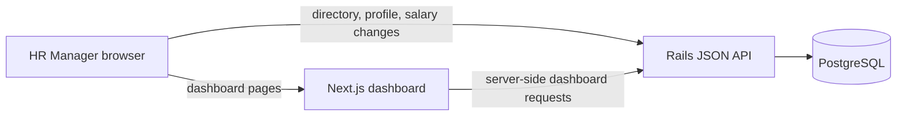

# Architecture notes

## System shape

The application has a Next.js interface, a Rails JSON API, and PostgreSQL. The web and API services are deployed separately on Render and share a database connection through the Render Blueprint.

The dashboard page loads overview, country and department breakdowns, and pay bands from the API. The employee directory and profile are client-side pages that call the API directly. `RAILS_API_URL` configures server-side dashboard requests; `NEXT_PUBLIC_RAILS_API_URL` configures browser requests. Both point to the same Rails service in deployment.

## Data model and compensation

- A department has many employees; an employee has a compensation history.
- Compensation stores local salary and USD-equivalent salary as integer cents. Exchange rates are fixed reference data stored in PostgreSQL, so reporting is reproducible.
- The salary-change endpoint validates its input and exchange rate, then locks the employee while it deactivates the current compensation and creates the replacement. The transaction keeps the active record and audit history consistent.
- The seed uses a fixed random seed and batched inserts to create up to 10,000 synthetic employees and active compensation records across five countries, eight departments, six job levels, and supported currencies.

## Query boundaries

- Directory filtering, sorting, pagination, and record counts run in the Rails/PostgreSQL query. The controller selects only fields needed for the response.
- Dashboard summaries and salary percentiles are database aggregates; they do not load all employee rows into Ruby.
- `PERFORMANCE.md` records a reproducible local baseline and its limits. It is a single-user measurement, not a production capacity claim.

## Verification and deliberate limits

Rails integration and model tests cover API behavior, validations, conversion, and salary history. Vitest and React Testing Library cover the dashboard view, employee directory, profile, API helper, and formatting helpers. The frontend is also checked with ESLint, TypeScript, and a production build.

This assessment demo has one HR persona and no authentication or role-based access. Seeded records are synthetic. The Render free-tier service can sleep when idle, and its free database has a limited lifetime; these deployment constraints are described in the repository README.
